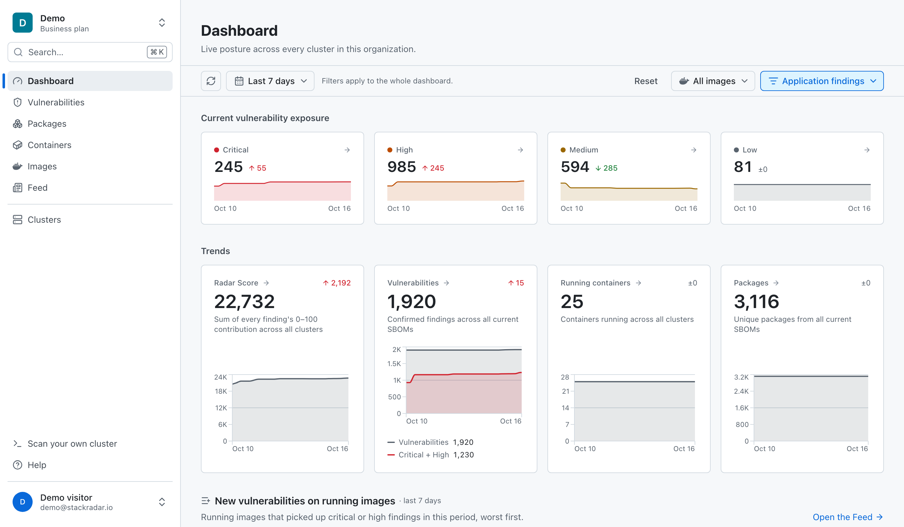
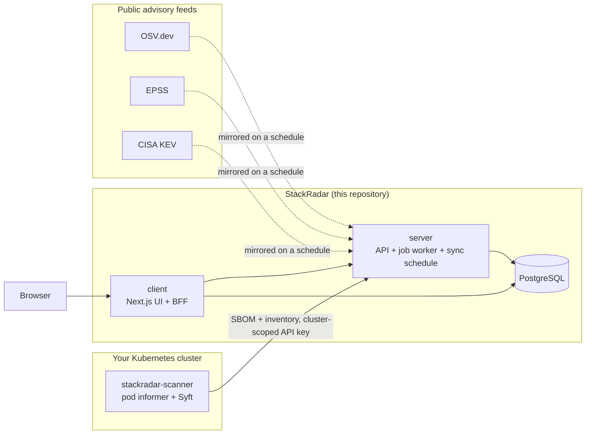

<h1>
   StackRadar
</h1>

**See every known vulnerability on the images actually running in your
Kubernetes cluster, ranked by what to fix first.** Self-hosted under
AGPL-3.0, or hosted at [app.stackradar.io](https://app.stackradar.io).

[](https://github.com/lockdep/stackradar/releases/latest)
[](https://github.com/lockdep/stackradar/actions/workflows/ci-test.yaml)
[](https://github.com/lockdep/stackradar/actions/workflows/codeql.yaml)
[](LICENSE)
[](#verifying-what-you-install)
[](https://artifacthub.io/packages/helm/lockdep/stackradar)
[](https://github.com/lockdep/stackradar/discussions)

A read-only scanner agent in the cluster generates a CycloneDX SBOM for
every image that runs and reports which namespace, workload, Helm release
and Argo CD application it runs in. The server keeps its own mirror of
[OSV.dev](https://osv.dev), [EPSS](https://www.first.org/epss/) and the
[CISA KEV catalogue](https://www.cisa.gov/known-exploited-vulnerabilities-catalog),
matches every SBOM against it, re-matches when the mirror changes, and
scores each finding by how likely it is to be exploited rather than by
CVSS alone. The dashboard answers "which pods run a new CVE" the moment the
advisory is published.



## Contents

* [Features](#features)
* [How it works](#how-it-works)
* [Quickstart (Helm)](#quickstart-helm)
* [Quickstart (Docker Compose)](#quickstart-docker-compose)
* [Community Edition vs StackRadar Cloud](#community-edition-vs-stackradar-cloud)
* [Distributions](#distributions)
* [Verifying what you install](#verifying-what-you-install)
* [Security](#security)
* [Documentation](#documentation)
* [Related repositories](#related-repositories)
* [Contributing](#contributing)
* [Community](#community)
* [Copyright & Licence](#copyright--licence)

## Features

* **Scans what runs, not what was built.** An event-driven agent watches the
  cluster's pods, pulls each image once per digest and generates its SBOM
  with [Syft](https://github.com/anchore/syft). One image in five
  namespaces is one pull, one SBOM and one matching pass.
* **Inventory with its delivery context.** Namespaces, workloads and
  containers, plus the Helm release that packaged a workload and the Argo CD
  application that delivers it: the chart version a CVE report cites and
  the place the fix is made are both on the page.
* **Your own vulnerability data.** The server mirrors OSV.dev for the
  ecosystems you choose, plus EPSS and KEV, and rebuilds the matches when
  the mirror changes. Nothing is sent anywhere to be scored.
* **Ranked by exploitability.** The Radar Score folds CVSS, EPSS and KEV
  into one number per finding and sums them per image, container, release
  and cluster, so the top of every list is what to fix first.
* **Fixes, not just findings.** Which tag or chart version to move to and
  what it removes, the `helm`, `argocd` or `kubectl` command that does it,
  and end-of-life verdicts for base images.
* **Base image versus your code.** Findings are split between the base
  image and the application layers, because most of them are in the base
  image and a rebuild on a newer base removes them all at once.
* **A feed of changes, not inventory.** New vulnerabilities on running
  images, containers that moved between digests with the finding delta
  between them, and scans whose results changed because the world did.
* **Sign-in that fits a self-hosted tool.** Local username and password with
  a bootstrap admin, any OpenID Connect provider, GitHub and Google.
* **Alerts on a Slack webhook** for new critical and KEV findings on
  running images, per organisation.
* **CycloneDX in and out.** Upload an SBOM by hand with `curl`; download
  the stored SBOM of any image.
* **One Postgres, migrations on boot, no telemetry.** The images never
  phone home; adoption is counted in pulls, issues and
  [ADOPTERS.md](ADOPTERS.md).

## How it works



Three components, two of them in this repository. The **scanner** watches
the pods of the cluster it runs in, generates one SBOM per image digest
and reports the full inventory (namespace, workload, container, Helm
release, Argo CD application) over an API key scoped to that cluster. The
**server** holds the SBOMs, mirrors the advisory feeds locally, matches
components against them by package URL and re-matches when the mirror
changes, and ranks every finding and every rollup. The **client** is the
dashboard and the only thing a browser talks to; it owns sign-in and
proxies the API. One PostgreSQL database carries both.

The full picture, with the trust boundaries, the data model and the
decisions behind them, is [docs/ARCHITECTURE.md](docs/ARCHITECTURE.md)
and the ADRs in [docs/adr/](docs/adr/).

## Quickstart (Helm)

One command on any Kubernetes 1.25+ cluster with Helm 3.8+. No values
file, no database to bring, no second command for the scanner:

```sh
helm install stackradar oci://ghcr.io/lockdep/helm-charts/stackradar \
  --create-namespace -n stackradar
kubectl -n stackradar port-forward svc/stackradar-client 3000:3000
```

Open <http://localhost:3000>, log in as `admin@stackradar.local` with the
password `admin`, and change it when asked. Your cluster's images are
already being scanned; they appear with findings once the vulnerability
mirror has bootstrapped (minutes, depending on your connection; the UI says
so until then). On a laptop cluster (kind, minikube, Docker Desktop) add
`-f https://raw.githubusercontent.com/lockdep/helm-charts/main/charts/stackradar/values-quickstart.yaml`
for trimmed resources and a two-minute, Alpine-only mirror.

> [!WARNING]
> The default install uses a bundled single-node Postgres and **public
> fixture credentials**: the database password, the service key, the
> encryption key, the session secret and the scanner's bootstrap key are
> the same on every install that leaves them at their defaults, and
> `helm install` prints a WARNING naming each one still in effect. Before
> relying on the install, set your own passwords and bootstrap key, or point
> it at your own database. The chart never generates a secret for you.
> [docs/self-hosting/helm.md](docs/self-hosting/helm.md) is the walkthrough.

## Quickstart (Docker Compose)

The try-out without a cluster. It cannot run the scanner, so it proves the
platform with an SBOM you upload yourself:

```sh
curl -LO https://raw.githubusercontent.com/lockdep/stackradar/main/deploy/compose/docker-compose.yml
docker compose up -d
```

Open <http://localhost:3000> and log in with the same default credentials.
[docs/self-hosting/docker-compose.md](docs/self-hosting/docker-compose.md)
has the two `curl` lines that upload an SBOM, and the same warning about
fixture secrets: keep it on your machine, or run `make quickstart` from
`deploy/compose/` in a checkout to rotate them before the first start.

## Community Edition vs StackRadar Cloud

One codebase, two configurations. The cloud at app.stackradar.io and a
self-hosted install run the same images; `STACKRADAR_EDITION=community` is
the default, and the cloud opts in. There is no fork and no feature flag
you cannot read in [`server/src/edition.ts`](server/src/edition.ts).

| | Community Edition | StackRadar Cloud |
|:--|:--|:--|
| Where it runs | Your cluster (`helm install stackradar`), or a laptop (Compose) | app.stackradar.io; you install only the scanner, with a key from the dashboard |
| Clusters | One: the cluster it runs in | Many in one dashboard, across networks and accounts |
| Postgres and the vulnerability mirror | You run them (a bundled Postgres by default) | We do |
| Sign-in | Local username/password, any OIDC provider, GitHub, Google | GitHub, Google and OIDC; enterprise SSO (SAML, SCIM, enforced SSO) is planned for the cloud only |
| Alerts | One Slack webhook per organisation | Email and Slack, with a weekly digest |
| Help | [Discussions](https://github.com/lockdep/stackradar/discussions) and issues | Support |
| Install command | `helm install stackradar …` | `helm install stackradar-scanner …` with a key |
| Price | Free. AGPL-3.0 | Free for one cluster; Pro and Business from $59 and $199 a month. See [stackradar.io/pricing](https://stackradar.io/pricing) |

Everything that is only sold on the cloud lives under
[`server/src/cloud/`](server/src/cloud/) and
[`client/src/cloud/`](client/src/cloud/), under its own licence (below),
and is mounted by one line when the edition is cloud. A contributor can see
where the boundary is, and CI ([cloud-boundary.yaml](.github/workflows/cloud-boundary.yaml))
keeps it mechanical.

## Distributions

Two images, built from this repository and released together under one
version:

| Image | What it is |
|:--|:--|
| `ghcr.io/lockdep/stackradar-server` | The API, the job worker and the OSV / EPSS / KEV sync schedule. In the default `monolith` topology all three run in one process. |
| `ghcr.io/lockdep/stackradar-client` | The web UI (Next.js), which also keeps its Auth.js tables in the `auth` schema of the same database. |

Tags: `:<version>` is immutable, `:<major>.<minor>` follows the newest
patch of that minor, `:latest` is the newest release, `:snapshot` is the
last merge to `main` ([`dev/docker-compose.yml`](dev/docker-compose.yml)
runs that one). Releases are built for `linux/amd64` and `linux/arm64`,
signed with Cosign (keyless), carry SLSA provenance and SBOM attestations
in the image index, and attach a CycloneDX SBOM of each image to the
[GitHub Release](https://github.com/lockdep/stackradar/releases).
[RELEASING.md](RELEASING.md) is the release process and the pin
recommendations. The scanner agent is a separate image and chart from
[lockdep/stackradar-scanner](https://github.com/lockdep/stackradar-scanner).

## Verifying what you install

Every release is signed with [cosign](https://docs.sigstore.dev/) keyless
signing. There is no public key to distribute: the signature is bound to
this repository's release workflow by a Sigstore certificate recorded in
the public Rekor transparency log.

```sh
VERSION=<version>
IDENTITY="^https://github.com/lockdep/stackradar/.github/workflows/publish.yaml@refs/tags/v${VERSION}\$"
ISSUER="https://token.actions.githubusercontent.com"

cosign verify \
  --certificate-identity-regexp "$IDENTITY" \
  --certificate-oidc-issuer "$ISSUER" \
  "ghcr.io/lockdep/stackradar-server:${VERSION}"

cosign verify \
  --certificate-identity-regexp "$IDENTITY" \
  --certificate-oidc-issuer "$ISSUER" \
  "ghcr.io/lockdep/stackradar-client:${VERSION}"
```

The chart pins both images by digest, so what you deploy is the exact
artifact that release built, signed and attested, regardless of where the
tag points later. The `:snapshot` images are signed too, by
`snapshot.yaml` at `refs/heads/main`; substitute that identity to verify
one.

## Security

* **The agent is read-only.** Its ClusterRole is `list` and `watch` on
  pods plus metadata-only `get` on their controllers; no `create`,
  `update`, `delete` or `patch` on anything. What leaves the cluster is an
  allowlist, documented line by line in the
  [scanner README](https://github.com/lockdep/stackradar-scanner#what-leaves-your-cluster).
* **No telemetry.** Neither image phones home. The only outbound traffic
  from a self-hosted install is the advisory mirror syncs.
* **Scanner keys are cluster-scoped.** An SBOM, its findings and its
  inventory belong to exactly one cluster; nothing derived from an upload
  is ever shared across clusters
  ([ADR 0006](docs/adr/0006-images-are-cluster-scoped.md)).
* **Signed, attested, multi-arch releases**, verifiable with the commands
  above. CodeQL and Dependabot run on every change.

Report a vulnerability privately through
[GitHub's private reporting](https://github.com/lockdep/stackradar/security/advisories/new)
or to security@stackradar.io; [SECURITY.md](SECURITY.md) has the scope,
the response time and the supported versions.

## Documentation

| | |
|:--|:--|
| [docs/self-hosting/](docs/self-hosting/) | The self-hosting manual: Helm walkthrough, Compose, users and local login, OIDC, your own Postgres, upgrading, backups |
| [Chart values reference](https://github.com/lockdep/helm-charts/blob/main/charts/stackradar/README.md) | Every value of the `stackradar` chart, in `lockdep/helm-charts` |
| [docs/ARCHITECTURE.md](docs/ARCHITECTURE.md) | The system, its trust boundaries, the data model and the data flow end to end |
| [docs/adr/](docs/adr/) | Architecture decision records: why images are the unit of identity, why risk is two layers, why the aggregate is an unbounded sum |
| [docs/contracts/](docs/contracts/) | The scanner wire format (`inventory-v3`) and the internal match endpoint |
| [docs/authorization-matrix.md](docs/authorization-matrix.md) | Who can do what: roles, keys and the endpoints they reach |
| [DEVELOPING.md](DEVELOPING.md) | Building, running and testing the two apps |
| [RELEASING.md](RELEASING.md) | How a version ships, and how to pin one |
| [stackradar.io/docs](https://stackradar.io/docs) | The hosted product's documentation |

## Related repositories

| Repository | What it is | Licence |
|:--|:--|:--|
| [lockdep/stackradar](https://github.com/lockdep/stackradar) | This one: the server, the web client, the Compose quickstart and the self-hosting docs | AGPL-3.0 |
| [lockdep/helm-charts](https://github.com/lockdep/helm-charts) | The `stackradar` Helm chart: both apps, a bundled Postgres and the scanner in one install | Apache-2.0 |
| [lockdep/stackradar-scanner](https://github.com/lockdep/stackradar-scanner) | The in-cluster agent and its own chart; the only SBOM ingestion path | Apache-2.0 |
| [lockdep/stackradar-cli](https://github.com/lockdep/stackradar-cli) | `stackradar scan`: the same question answered from a laptop, with no account and no agent | Apache-2.0 |

## Contributing

Contributions in every shape are welcome: a question that shows where the
docs are unclear, a defect report with a reproduction, a documentation
fix, a pull request. [CONTRIBUTING.md](CONTRIBUTING.md) says how to ask,
file and send code (commits are signed off under the
[Developer Certificate of Origin](https://developercertificate.org/); there
is no CLA), [DEVELOPING.md](DEVELOPING.md) says how to build and run it,
and [CODE_OF_CONDUCT.md](CODE_OF_CONDUCT.md) is the Contributor Covenant.

Issues labelled [`good first issue`](https://github.com/lockdep/stackradar/issues?q=is%3Aopen+label%3A%22good+first+issue%22)
and [`help wanted`](https://github.com/lockdep/stackradar/issues?q=is%3Aopen+label%3A%22help+wanted%22)
are the ones to start with.

## Community

* Questions and ideas: [GitHub Discussions](https://github.com/lockdep/stackradar/discussions)
* Defects and enhancements: [GitHub Issues](https://github.com/lockdep/stackradar/issues)
* Security reports: [SECURITY.md](SECURITY.md)
* Who runs it: [ADOPTERS.md](ADOPTERS.md)
* Website: <https://stackradar.io>

## Copyright & Licence

StackRadar is Copyright (C) 2026 LockDep. All rights reserved.

The code in this repository is licensed under the
[GNU Affero General Public License, version 3 only](LICENSE), with one
exception: the files under `server/src/cloud/` and `client/src/cloud/` are
source-available under the [StackRadar Cloud Licence](server/src/cloud/LICENSE),
which allows anything except offering them as a hosted or managed service.
The scanner agent, the CLI and the Helm chart are Apache-2.0. The licence
covers the code, not the name; see [NOTICE](NOTICE) for the trademark
terms.
